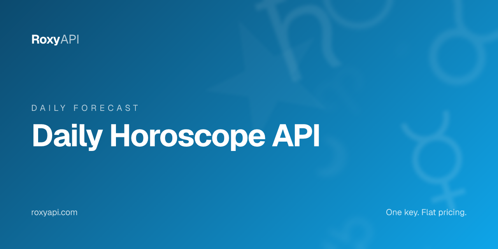

[](https://roxyapi.com/products/astrology-api)

# Daily Horoscope API

> Daily horoscope by zodiac sign with transit-based forecasts and house activations. One key covers 10 spiritual domains. MCP-first, no local setup required.

[](https://roxyapi.com/pricing)
[](https://roxyapi.com/api-reference)
[](https://roxyapi.com/methodology)
[](https://roxyapi.com/docs/mcp)
[](https://roxyapi.com/docs/sdk)

## What is Daily Horoscope API

The RoxyAPI daily horoscope endpoint returns a transit-based forecast for any zodiac sign with house activations unique to each sign. The forecast is generated from real-time planetary transits using whole-sign house positions, so every sign receives different content. Each call ships overview, love, career, health, finance, daily advice, lucky number, lucky color, compatible signs, active transits, Moon sign, Moon phase, and an energy rating from 1 to 10. One RoxyAPI subscription covers 10 spiritual domains, all calculations powered by Roxy Ephemeris, verified against NASA JPL Horizons.

## Why this API

| Property | Value |
|----------|-------|
| Coverage | 10 spiritual domains in one subscription |
| Calculation | Roxy Ephemeris, verified against NASA JPL Horizons |
| MCP server | `https://roxyapi.com/mcp/astrology` (Streamable HTTP, no local setup) |
| SDKs | TypeScript on npm `@roxyapi/sdk`, Python on PyPI `roxy-sdk` |
| Pricing | One key, flat per call, $39 for 25K calls |
| Licensing | Personal and commercial use, including closed source apps. No AGPL or GPL entanglement. [Full terms](https://roxyapi.com/policy/license) |
| Last verified | 2026-Q2 |

## Quick start

1. Get a key at [roxyapi.com/pricing](https://roxyapi.com/pricing)
2. Pick a language below
3. Copy the snippet, run, ship

### cURL

```bash
# Daily horoscope by sign. Defaults to today. Pass ?date=YYYY-MM-DD for a specific day.
curl -s "https://roxyapi.com/api/v2/astrology/horoscope/aries/daily" \
  -H "X-API-Key: $ROXY_API_KEY"

# Or with an explicit date for editorial scheduling
curl -s "https://roxyapi.com/api/v2/astrology/horoscope/aries/daily?date=2026-05-07" \
  -H "X-API-Key: $ROXY_API_KEY"
```

### Python

```python
import os
from roxy_sdk import create_roxy

roxy = create_roxy(os.environ["ROXY_API_KEY"])

# Daily horoscope. Highest per-user call frequency in the catalog, drives DAUs and push.
horoscope = roxy.astrology.get_daily_horoscope(sign="aries")

print(horoscope["sign"])           # Aries
print(horoscope["date"])           # 2026-05-07
print(horoscope["overview"])       # Saturn in Aries demands focus and discipline...
print(horoscope["love"])           # Venus in your third house makes your words sweet...
print(horoscope["luckyNumber"])    # 20
print(horoscope["luckyColor"])     # Red
print(horoscope["moonPhase"])      # Waning Gibbous Moon
print(horoscope["energyRating"])   # 7
```

### JavaScript (Node)

```js
import { createRoxy } from '@roxyapi/sdk';

const roxy = createRoxy(process.env.ROXY_API_KEY);

// Daily horoscope by zodiac sign with transit-driven content unique per sign
const { data, error } = await roxy.astrology.getDailyHoroscope({
  path: { sign: 'aries' },
});

if (error) throw new Error(error.error);

console.log('Sign:', data.sign);                    // Aries
console.log('Date:', data.date);                    // 2026-05-07
console.log('Overview:', data.overview);
console.log('Love:', data.love);
console.log('Career:', data.career);
console.log('Lucky number:', data.luckyNumber);     // 20
console.log('Lucky color:', data.luckyColor);       // Red
console.log('Moon phase:', data.moonPhase);         // Waning Gibbous Moon
console.log('Energy rating:', data.energyRating);   // 7 / 10
```

### TypeScript

```ts
import { createRoxy } from '@roxyapi/sdk';

const roxy = createRoxy(process.env.ROXY_API_KEY!);

// Daily horoscope: returns sign, date, overview, love, career, health, finance, lucky fields, transits, moon data
const { data, error } = await roxy.astrology.getDailyHoroscope({
  path: { sign: 'aries' },
});

if (error) throw new Error(error.error);

console.log('Sign:', data.sign);
console.log('Date:', data.date);
console.log('Overview:', data.overview);
console.log('Compatible signs:', data.compatibleSigns);
console.log('Active transits:', data.activeTransits);
console.log('Moon sign:', data.moonSign);
console.log('Moon phase:', data.moonPhase);
console.log('Energy rating:', data.energyRating, '/ 10');
```

## Request schema

| Field | Type | Required | Description |
|-------|------|----------|-------------|
| `sign` | string (path) | yes | Zodiac sign, case-insensitive (e.g., aries, Aries, ARIES all work). |
| `date` | string (query) | no | Forecast date in YYYY-MM-DD format. Defaults to today. Supports future and past dates for editorial scheduling. |
| `lang` | string (query) | no | Interpretation language. Supported: en, tr, de, es, hi. Defaults to en. |

## Response shape

```json
{
  "sign": "Aries",
  "date": "2026-05-07",
  "overview": "Saturn in Aries demands focus and discipline today. The effort you invest now builds something that endures.",
  "love": "Venus in your third house makes your words sweet and persuasive. Flirtatious conversations and heartfelt messages hit their mark.",
  "career": "Take responsibility seriously at work. Hard work brings lasting results, even when progress feels invisible.",
  "health": "Energy levels peak today. Great for physical activities, bold action, and breaking through inertia.",
  "finance": "Jupiter in your fourth house favors real estate, home investments, and family-related finances.",
  "advice": "Mercury in your second house sharpens financial thinking. Review budgets, negotiate deals, and research purchases.",
  "luckyNumber": 20,
  "luckyColor": "Red",
  "compatibleSigns": ["Leo", "Sagittarius", "Gemini"],
  "activeTransits": [
    "Saturn in Aries (1st house of identity and self-expression)",
    "Mars in Aries (1st house of identity and self-expression)",
    "Venus in Gemini (3rd house of communication and learning)"
  ],
  "moonSign": "Capricorn",
  "moonPhase": "Waning Gibbous Moon",
  "energyRating": 7
}
```

| Field | Type | Description |
|-------|------|-------------|
| `sign` | string | Zodiac sign for this horoscope. |
| `date` | string | Date of this daily horoscope (YYYY-MM-DD). |
| `overview` | string | General daily overview based on Moon house activation and planetary transits. Unique per sign based on whole-sign house positions. |
| `love` | string | Love and relationship forecast. Based on Venus house position relative to this sign. |
| `career` | string | Career and professional outlook. Based on Mars house position relative to this sign, with Saturn and Jupiter influences. |
| `health` | string | Health, energy, and wellness guidance for the day. |
| `finance` | string | Financial outlook and money-related guidance. |
| `advice` | string | Actionable daily advice based on the dominant transit energy. |
| `luckyNumber` | number | Lucky number for the day. |
| `luckyColor` | string | Lucky color for the day, derived from the sign element. |
| `compatibleSigns` | array | Most compatible zodiac signs. Trine partners (same element) followed by a sextile partner (complementary element). Use for compatibility widgets, dating app onboarding, and horoscope cards. |
| `activeTransits` | array | Active planetary transits affecting this sign today, with house activations. Each transit shows the planet, its current sign, and which house it activates for the queried sign. |
| `moonSign` | string | Current Moon sign. Changes every 2-3 days, sets the emotional tone for all signs. |
| `moonPhase` | string | Current lunar phase (New Moon, Waxing Crescent, First Quarter, Waxing Gibbous, Full Moon, Waning Gibbous, Last Quarter, Waning Crescent). |
| `energyRating` | number | Overall energy intensity for this sign today (1-10). Higher when more transits activate this sign directly. Useful for content widgets and visual indicators. |

## Common use cases

| Use case | Endpoint flow |
|----------|---------------|
| Daily zodiac widget for a content site | GET `/astrology/horoscope/{sign}/daily` for each sign at 00:00 UTC, cache for 1 hour |
| Push notification copy for a horoscope app | GET `/astrology/horoscope/{sign}/daily?date=tomorrow` overnight, schedule local-time delivery |
| Dating app onboarding compatibility prompt | GET `/astrology/horoscope/{sign}/daily`, surface `compatibleSigns` and Moon sign |
| Editorial scheduling for a magazine | GET `/astrology/horoscope/{sign}/daily?date=YYYY-MM-DD` to pre-generate a week of content |
| Lunar-cycle wellness card | GET `/astrology/horoscope/{sign}/daily`, surface `moonPhase` and `energyRating` |

## Related endpoints in this domain

- `GET /astrology/horoscope/{sign}/weekly` (`getWeeklyHoroscope`) - 7-day transit forecast with lucky days, lucky numbers, and compatible signs
- `GET /astrology/horoscope/{sign}/monthly` (`getMonthlyHoroscope`) - 30-day forecast with week-by-week breakdown and real lunar phase key dates
- `GET /astrology/moon-phase/current` (`getCurrentMoonPhase`) - current lunar phase, illumination, age, and upcoming phases for context

## Use this in your AI agent

Connect Claude, GPT, Gemini, or Cursor to RoxyAPI through the remote MCP server. No Docker. No self hosting. The full MCP tool catalog for this domain is at `https://roxyapi.com/mcp/astrology`.

```json
{
  "mcpServers": {
    "astrology": {
      "url": "https://roxyapi.com/mcp/astrology",
      "headers": { "X-API-Key": "$ROXY_API_KEY" }
    }
  }
}
```

See [docs/mcp](https://roxyapi.com/docs/mcp) for Claude Desktop, Cursor, Windsurf, VS Code, and Claude Code setup.

## For AI coding agents

This repo ships an [AGENTS.md](AGENTS.md) execution playbook. Cursor, Claude Code, Aider, Codex, Windsurf, RooCode, and Gemini CLI will pick it up automatically. Top level overview lives at [roxyapi.com/AGENTS.md](https://roxyapi.com/AGENTS.md).

## Resources

- [Methodology and gold standard tests](https://roxyapi.com/methodology) verified against NASA JPL Horizons
- [Full API reference](https://roxyapi.com/api-reference) interactive Scalar UI
- [TypeScript SDK on npm](https://www.npmjs.com/package/@roxyapi/sdk)
- [Python SDK on PyPI](https://pypi.org/project/roxy-sdk/)
- [llms.txt](https://roxyapi.com/llms.txt) full LLM citation index
- [Top level AGENTS.md](https://roxyapi.com/AGENTS.md)

## Other RoxyAPI samples

[](https://github.com/RoxyAPI/kp-astrology-api)
[](https://github.com/RoxyAPI/kundli-api)
[](https://github.com/RoxyAPI/synastry-api)
[](https://github.com/RoxyAPI/panchang-api)
[](https://github.com/RoxyAPI/biorhythm-api)

## License

MIT for this sample repo. See [LICENSE](LICENSE).

**Catalog licensing:** Personal and commercial use, including closed source proprietary apps. No AGPL or GPL entanglement. RoxyAPI APIs and SDKs are safe to embed in commercial products. Full terms at [roxyapi.com/policy/license](https://roxyapi.com/policy/license).

## Contact

- Site: [roxyapi.com](https://roxyapi.com)
- Status: [roxyapi.com/api-reference](https://roxyapi.com/api-reference)
